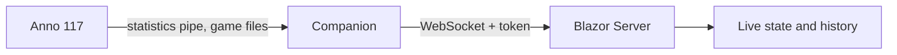

# Architecture

<!-- project:begin architecture -->
Censio reads the statistics of a running Anno 117 game on Windows and shows them live and over time in a
web application. A Windows Companion extracts the data; a Blazor Server application stores and displays it.

## Components

- **Companion** (Windows): reads the Anno 117 statistics pipe and the game files and sends the data to the server.
  Its logic lives in the platform-neutral `Censio.Companion.Core`; `Censio.Companion` is the thin Windows tray
  shell around it ([`decisions/0004`](decisions/0004-companion-shell-and-linux-build.md)). In local mode it also hosts the server below in its own process, on the loopback addresses of the PC alone ([`areas/local-mode.md`](areas/local-mode.md), records [0098](decisions/0098-companion-hosts-the-server-from-a-reference-with-bundled-web-assets.md) to [0101](decisions/0101-local-replay-sent-to-the-hosted-server-with-the-token-in-memory.md), [0015](decisions/0015-two-deliverables-and-local-mode.md), *Consequences*).
- **Server** (Blazor Server): receives the data over a WebSocket on `/ingest` (token-authenticated), keeps the current state per profile and the history (ticks for 7 days, then hourly values), deletes a profile's history on request, and renders them.

The solution `Censio.slnx` holds eight production projects under `src/`, each with a test project under `tests/`
except the Windows shell:

| Project | Responsibility | References |
| ------- | -------------- | ---------- |
| `Censio.Contracts` | The types shared by Companion and server: the catalog document with its reader and writer ([`areas/game-catalog-format.md`](areas/game-catalog-format.md)), the contract messages with their reader and writer ([`areas/contract.md`](areas/contract.md)), and the product version | — |
| `Censio.Pipe` | Framing and parsing the statistics pipe into typed messages and assembling them into ticks, recording frames to a file and replaying it, and anonymising a recording ([`areas/pipe.md`](areas/pipe.md), [`areas/pipe-recording.md`](areas/pipe-recording.md)) | — |
| `Censio.GameData` | Reading the game files (the RDA archives), building the catalog of names from them and reading the goods' and regions' icons from the UI archives (BC7 to PNG by own code) ([`areas/game-files.md`](areas/game-files.md), [`areas/game-catalog.md`](areas/game-catalog.md), [`areas/game-catalog-icons.md`](areas/game-catalog-icons.md), [`areas/game-catalog-cache.md`](areas/game-catalog-cache.md)) | — |
| `Censio.Server.Data` | Persistence of the server: the SQLite database with EF Core migrations, and the stores for profiles, ticks, islands, the catalog and icons ([`areas/server-data.md`](areas/server-data.md)) and for the history: hourly points, the series read ([`areas/history.md`](areas/history.md)), the deletion of a profile ([`areas/history-deletion.md`](areas/history-deletion.md)) | Contracts |
| `Censio.Server` | Web host, UI (frame, themes and languages, [`areas/web-ui.md`](areas/web-ui.md)), the ingest endpoint ([`areas/ingest.md`](areas/ingest.md)) with its token ([`areas/ingest-token.md`](areas/ingest-token.md)), the current state per profile ([`areas/server-state.md`](areas/server-state.md)), the retention job ([`areas/history.md`](areas/history.md)); `CensioServer` is the one set-up of the standalone server and of the one the Companion hosts ([`areas/local-mode.md`](areas/local-mode.md)) | Contracts, Server.Data |
| `Censio.Companion.Core` | The Companion's platform-neutral logic (tray menu and snapshot, single-instance rule, pipe connection state machine, command line, recording session and replay runner, tooltip texts, diagnostics window content and session, the log file writer, the autostart rules, the game installation search and the settings file, the catalog and icon loading, the catalog cache, the conversion of the catalog into the catalog document and the check of tick GUIDs, the local server session, its settings and menu line, the replay into it, and the live sender with the connection it shares with the replay, [`areas/live-sending.md`](areas/live-sending.md)) | Contracts, Pipe, GameData, Server |
| `Censio.Anonymiser` | Contributor console tool that anonymises a recording; not released ([`areas/pipe-recording.md`](areas/pipe-recording.md), *Anonymising*) | Pipe |
| `Censio.Companion` | The Windows tray shell (WPF application, Windows Forms tray icon, the diagnostics window (with the icons shown as images), the registry store of the autostart value, the registry reader of Ubisoft Connect's install records, the file version reader, the start of the hosted server and the browser launch, and the build target that bundles the server's web assets into the one exe); no test project | Companion.Core |

All assemblies carry the version of the build property `Version` (default `0.0.0`) as informational version
([`decisions/0005`](decisions/0005-product-version-from-one-build-property.md)). What each component does is in
[`areas/`](areas/README.md).

## Data flow

The Companion parses the pipe stream and the game files, extracts the game data and pushes it to the server.
The pipe stream is parsed strictly: a frame the parser cannot read is reported as an error, never guessed
([`decisions/0033`](decisions/0033-pipe-reader-strict-from-the-reference-source.md)); the game's side of the pipe as
observed is in [`protocol.md`](protocol.md).
The Companion opens the pipe itself, reconnects when the game restarts and shows the connection state in its tray
tooltip ([`decisions/0035`](decisions/0035-pipe-connection-states-retry-and-identification-level.md),
[`areas/pipe-connection.md`](areas/pipe-connection.md)). The Companion groups the messages into ticks with an island identity and session events
([`decisions/0034`](decisions/0034-ticks-assembled-by-close-rules-on-an-injected-clock.md)), in the live connection as in a replay, and the tray and the diagnostics window show the latest closed tick ([`decisions/0038`](decisions/0038-diagnostics-window-flat-table-of-rows-made-on-demand.md)).
From the tray menu (or from the start with `--record`) the Companion writes the frames of each connection to a local file, and with `--replay` it feeds
such a file through the same message reader and tick assembler instead of the pipe
([`decisions/0036`](decisions/0036-pipe-recording-raw-frames-and-replay-on-a-recorded-clock.md),
[`areas/pipe-recording.md`](areas/pipe-recording.md)).
A contributor can turn such a file into an anonymised copy with `Censio.Anonymiser`, the only way a recording may be committed as a test fixture
([`decisions/0042`](decisions/0042-recordings-anonymised-by-a-contributor-tool-rewriting-frames.md)).
The Companion logs through .NET's logging abstraction into its own rotating text file in the local app data folder
([`decisions/0037`](decisions/0037-companion-log-through-the-logging-abstraction-to-own-rotating-file.md),
[`areas/companion-log.md`](areas/companion-log.md)).
Once per start the Companion looks for the game installation in the background: the folder named in its settings file, else Ubisoft Connect's install records and default games folder, and shows the result and the program file's version as the build in the tray menu ([`decisions/0044`](decisions/0044-game-installation-found-through-ubisoft-connect-or-the-settings-file.md), [`decisions/0046`](decisions/0046-game-build-is-the-program-files-version.md), [`areas/game-installation.md`](areas/game-installation.md)).
At every start the Companion also loads or builds a catalog of regions, goods, workforce and buildings with their English and German names from the installation's `config.rda` in the background, shows them in the diagnostics window and logs the GUIDs it cannot name once. After the names it reads the icons of goods and regions from `ui.rda` and the `zz_patchfiles_<n>` archives, converts them to PNG, and shows them in the same window. A complete extraction is saved in a private cache file under `%LOCALAPPDATA%\Censio\Cache` (never sent), keyed by the game's file properties and the Companion's own build, so the next start loads it without reading the archives; each new pipe connection checks the game for a change and extracts again when it changed ([`decisions/0052`](decisions/0052-catalog-cache-keyed-by-file-properties-and-companion-identity.md), [`decisions/0053`](decisions/0053-catalog-cache-one-binary-file-validated-whole-before-use.md); [`decisions/0050`](decisions/0050-icons-found-by-a-path-rule-in-the-ui-and-patch-archives-newest-copy-wins.md), [`decisions/0051`](decisions/0051-dds-icons-decoded-by-own-bc7-and-png-code.md); [`decisions/0047`](decisions/0047-game-catalog-read-forward-only-from-config-rda-kinds-and-regions-from-the-data.md), [`decisions/0048`](decisions/0048-catalog-names-shown-in-the-diagnostics-window-unresolved-guids-logged-once.md), [`areas/game-catalog.md`](areas/game-catalog.md), [`areas/game-catalog-icons.md`](areas/game-catalog-icons.md), [`areas/game-catalog-cache.md`](areas/game-catalog-cache.md)).
The catalog converts into the versioned catalog document of `Censio.Contracts`, which live sending uploads to the server after the hello of each connection and when a re-extraction ends (records [`0107`](decisions/0107-catalog-uploaded-first-on-each-live-connection-deferred-after-a-failure.md) and [`0108`](decisions/0108-companion-reads-a-larger-reply-only-for-a-catalog-acknowledgement.md), [`areas/live-sending.md`](areas/live-sending.md), *Catalog*; a replay sends none) ([`decisions/0055`](decisions/0055-catalog-document-refers-to-icons-by-content-hash.md), [`decisions/0056`](decisions/0056-catalog-document-read-strictly-by-exact-schema-version.md), [`areas/game-catalog-format.md`](areas/game-catalog-format.md)).
The Companion converts ticks, trade routes, session events and its pipe state into the messages of contract version 2, which a replay with `--server` sends one message at a time to a server (live sending is described below; [`decisions/0079`](decisions/0079-recordings-sent-to-a-server-by-companion-replay-switches.md), [`areas/replay-sending.md`](areas/replay-sending.md); [`decisions/0058`](decisions/0058-contract-read-strictly-by-exact-version-with-a-frozen-hello.md), [`decisions/0059`](decisions/0059-contract-messages-carry-a-companion-assigned-identity-and-their-profile.md), [`decisions/0060`](decisions/0060-contract-message-bound-caps-ticks-below-the-pipes-limits.md), [`decisions/0096`](decisions/0096-contract-version-2-adds-trade-routes-read-exactly.md), [`areas/contract.md`](areas/contract.md)).
The server takes the messages on the WebSocket endpoint `/ingest`: a connection must open with a hello of contract version 2 that carries the ingest token, the server accepts one Companion at a time, finds a silent connection by WebSocket pings, stores each message before it answers it with an acknowledgement ([`decisions/0068`](decisions/0068-ingest-acknowledges-a-message-only-after-it-is-stored.md), [`areas/ingest.md`](areas/ingest.md), [`decisions/0061`](decisions/0061-ingest-token-generated-into-a-file-of-the-data-directory.md), [`decisions/0062`](decisions/0062-one-companion-second-refused-silence-found-by-websocket-pings.md), [`decisions/0063`](decisions/0063-refused-contract-messages-acknowledged-by-id-or-the-connection-closed.md), [`decisions/0064`](decisions/0064-ingest-refuses-browser-upgrades-and-bounds-pending-hellos.md)).
The server opens its SQLite database at start, after the key ring and the ingest token and before it listens, creates it or brings it to the current schema by migrations in one transaction, and stops the start when the file is unusable ([`areas/server-data.md`](areas/server-data.md), [`decisions/0065`](decisions/0065-database-schema-kept-by-migrations-applied-at-start.md), [`decisions/0066`](decisions/0066-database-file-setting-and-in-memory-without-data-directory.md), [`decisions/0067`](decisions/0067-ticks-stored-as-rows-with-float-bit-patterns.md)). The ingest writes profiles, ticks, the latest trade routes of a profile, the catalog and icons into the store before it acknowledges them. The server holds the current state of the two profiles with the newest ticks in memory, reads it back from the database before it listens, and tells its followers of each change, also of the Companion's connection and game state ([`areas/server-state.md`](areas/server-state.md), [`decisions/0069`](decisions/0069-current-state-of-the-newest-profiles-held-in-memory-and-restored-at-start.md), [`decisions/0075`](decisions/0075-companion-connection-and-game-state-held-in-the-server-state.md)). The data pages show it: the region overview, the island list and the island detail with its goods, the trade routes of a profile, the as-of line and the Companion banner, the profile switch, and `/icons/{reference}`, which serves a stored icon after a PNG header check. A page keeps only a view derived from the state, reads a profile that is not held one at a time, and follows the state live ([`areas/web-pages.md`](areas/web-pages.md), [`decisions/0073`](decisions/0073-islands-grouped-by-the-catalog-region-of-their-session.md), [`0074`](decisions/0074-pages-keep-derived-views-and-read-unheld-profiles-one-at-a-time.md), [`0076`](decisions/0076-icons-served-by-content-hash-after-a-png-header-check.md), [`0077`](decisions/0077-page-address-carries-the-shown-profile.md), [`0078`](decisions/0078-times-shown-at-the-browsers-utc-offset.md), [`0097`](decisions/0097-latest-trade-routes-per-profile-stored-as-rows-on-a-page-of-their-own.md)).
The server keeps a tick at full resolution for 7 days. A retention job, started after the server listens, folds older ticks one tick per write transaction into hourly sums and counts that stay without limit, so an ingest write waits for at most one step ([`decisions/0083`](decisions/0083-history-folded-tick-by-tick-into-hourly-sums-and-counts.md), [`areas/history.md`](areas/history.md)). A profile's history is deleted on request from its region overview: its profile row, islands and trade routes go in one short transaction, its ticks and hourly points are hidden behind a tombstone and removed in steps, and the database file is cleared of them by secure delete and a truncating checkpoint ([`decisions/0084`](decisions/0084-profile-deleted-in-steps-and-cleared-from-the-file.md), [`areas/history-deletion.md`](areas/history-deletion.md)).
In local mode ([`areas/local-mode.md`](areas/local-mode.md)) the Companion starts the server of `Censio.Server` in its own process, in the background, when the settings file says `"mode": "local"` (record [0099](decisions/0099-local-mode-switched-on-in-the-settings-file-off-by-default.md)): on `127.0.0.1` and `[::1]` at the port `localPort` (default 5000), with its data in `%LOCALAPPDATA%\Censio\Server`. The tray menu shows its state and `Open Censio` opens its pages in the browser. A replay without `--server` waits for it, takes its token from the process and sends to `127.0.0.1` ([`decisions/0101`](decisions/0101-local-replay-sent-to-the-hosted-server-with-the-token-in-memory.md), [`areas/replay-sending.md`](areas/replay-sending.md)); its live data goes the same way (below).
With `"mode": "forward"`, `serverAddress` and an optional `serverToken` in the settings file the Companion sends the pipe's live data to a server elsewhere, and in local mode to its hosted server on `127.0.0.1` ([`areas/live-sending.md`](areas/live-sending.md), records [0102](decisions/0102-live-data-goes-to-one-fixed-profile-live-until-profiles-are-chosen.md), [0103](decisions/0103-forward-server-address-and-token-are-keys-of-the-settings-file.md) and [0104](decisions/0104-live-sending-reconnects-holds-messages-in-memory-and-pings.md)). It connects at start, without waiting for the game, with a hello that names the fixed profile `Live`, sends every tick, trade-routes item and session event in the order read with one message in flight, keeps the waiting messages in a buffer of files in `%LOCALAPPDATA%\Censio\Buffer` within an age and a size limit (record [0105](decisions/0105-unsent-live-messages-kept-one-file-each-in-a-fixed-buffer-folder.md), [`areas/live-sending.md`](areas/live-sending.md), *Buffer*), uploads the catalog and the icons the server lacks before the waiting messages (a catalog whose upload failed waits behind them, and is given up after three failed connections), reconnects with growing delays and finds a connection that went silent by its own WebSocket pings; a refused token or contract version is not retried.
The server accepts data only from a client that presents the ingest token, unless the setting `Censio:Ingest:RequireToken` is switched to `false` (record 0019). Guarantees are listed in
`.squad/project.md` (*Guarantees*) and linked to their decision record as they are made.

## Configuration

Configuration (server address, data directory, database file, ingest token, cache and recording paths) comes from files and environment
variables and is validated at startup. The server generates the ingest token into the file `ingest-token` of its data directory at its first start, or, with the setting `Censio:Ingest:TokenFile` set, reads it from that file instead; only the setting `Censio:Ingest:RequireToken` switches the token off, and a start with an unreadable or invalid token file, an invalid switch, or a token file together with the switch `false` fails before the server listens ([`areas/ingest-token.md`](areas/ingest-token.md)). The database is `censio.db` in the data directory unless the setting `Censio:Database:File` names another absolute path; without either it is kept in memory with a warning ([`areas/server-data.md`](areas/server-data.md)). The Companion's settings, the game folder and, for local mode, `mode` and `localPort`, are the optional file `%LOCALAPPDATA%\Censio\settings.json`, hand-edited and never written by the Companion ([`decisions/0045`](decisions/0045-companion-settings-in-a-json-file-under-local-app-data.md), [`decisions/0099`](decisions/0099-local-mode-switched-on-in-the-settings-file-off-by-default.md), [`areas/companion.md`](areas/companion.md), *Settings file*, [`areas/local-mode.md`](areas/local-mode.md)); the server hosted by the Companion takes no environment variable and no configuration file, only what the Companion passes ([`decisions/0098`](decisions/0098-companion-hosts-the-server-from-a-reference-with-bundled-web-assets.md)). The rules per area are in [`areas/`](areas/README.md).

## Security model

Untrusted input: the statistics pipe, the game files, the Companion's settings file, Ubisoft Connect's install records, the WebSocket ingest and the browser's preference cookies and language header. The ingest token authenticates the
Companion; cache and recording paths are never derived from external input unchecked. Kept in sync with
`SECURITY.md` and the *Security areas* in `.squad/project.md`.

The Companion opens the pipe `\\.\pipe\anno117` read-only and at impersonation level identification, so the pipe's
server cannot act with the player's Windows identity; a pipe created by another program is read within the reader's
limits ([`areas/pipe-connection.md`](areas/pipe-connection.md), record 0035).

The game's RDA archives, found under a caller-named installation folder, are opened read-only and shared with the game,
and read within the reader's limits on blocks, entries and sizes; what the reader finds comes back as typed results,
never as exceptions, and no archive content leaves the machine ([`areas/game-files.md`](areas/game-files.md),
record 0043).

The settings file and Ubisoft Connect's install records are read only, within a 1 MiB bound for the file, into typed results that fail closed; no UNC or device path written in a record is followed, and a UNC folder the player writes in the settings file is probed over the network as the player's own choice ([`areas/game-installation.md`](areas/game-installation.md), record 0044).

The Companion makes at most two kinds of outbound connection. The first is the WebSocket of a replay to the server named by `--server`, directly, without a system proxy and without following a redirect; `wss://` is checked by the operating system's certificates and cannot be switched off, and over `ws://` the token and the data cross the network unencrypted. It reads the token from the file named by `--token-file` (at most 64 KiB, byte order marks accepted), never from the command line, and presents it in the hello only; no log line, status text or other message holds the token or the address, and a reply is read up to 64 KiB ([`areas/replay-sending.md`](areas/replay-sending.md), records 0079 and 0080). The second exists in local mode only: a replay without `--server` connects to `ws://127.0.0.1:<port>/ingest`, the address built from the port of the settings, with the token of the hosted server held in memory and never read from a file or logged (record 0101).

In local mode the Companion also listens: the hosted server binds `127.0.0.1` and `[::1]` (IPv4 alone without IPv6), never another address, answers only the `Host` names `localhost`, `127.0.0.1` and `[::1]` (any other, and none, with `400`, so a page of another site that points its name at `127.0.0.1` cannot read the pages), reads no environment variable and no configuration file, and sends only its warning-and-above log lines to the Companion's log. The ingest token stays required. Every program and every other signed-in user of the same PC can still reach the port, read every profile and delete history; without the token, which lies in the player's private folder, none can send data (accepted, [`areas/local-mode.md`](areas/local-mode.md), records [0098](decisions/0098-companion-hosts-the-server-from-a-reference-with-bundled-web-assets.md), [0100](decisions/0100-local-server-on-loopback-only-with-host-filtering.md), 0006).

The ingest token is 256 bits from a cryptographic random source, kept in an owner-only file of the data directory (Linux; on Windows the file takes its folder's rules), or set by the operator in a configured file with at least 32 characters (whose access rules are the operator's); it is never logged and is compared by its hash in fixed time. The endpoint refuses browser upgrades (an `Origin` header), reads the unauthenticated first message at 32 KiB and within 10 seconds, bounds the connections waiting for their hello at 16 and, per client address, at 4, blocks an address for 60 seconds after 10 failed hellos within 60 seconds (never trusting `X-Forwarded-For`), bounds every send at 30 seconds and every message at 24 MiB, and reads past 32 KiB only for the one accepted Companion. With the token switched off anyone who reaches the server can send data; many hosts, a proxy that makes all clients one address and a token holder that sends only pings or `status` messages and never reads remain ([`areas/ingest.md`](areas/ingest.md), [`areas/ingest-token.md`](areas/ingest-token.md), *Accepted risks*; records 0019, 0061 to 0064, 0082).

The database file, the files SQLite keeps beside it and a folder the server creates for it are readable by their owner only on Linux (on Windows the file takes its folder's rules), because they hold private profile, island, trade route and folder names; the server logs the path of the file and no name or stored value, and every statement is parameterized ([`areas/server-data.md`](areas/server-data.md)).

The server speaks plain HTTP only; TLS is the reverse proxy's job. Its start page, the data pages, `/icons/{reference}` and `/health` need no login, `/ingest` authenticates by its hello, and
`/health` reveals only its status ([`decisions/0006`](decisions/0006-server-plain-http-and-open-health.md),
[`areas/server.md`](areas/server.md)). Outside the Docker image it listens on loopback only; the image listens on
all interfaces of the container, and the published port decides who can reach it (record 0006).
The one state-changing action of the pages, deleting a profile's history, starts only from a page that was opened by an IP address, as `localhost` or by a host name the setting `AllowedHosts` lists, so a page of another site (DNS rebinding) cannot start it; behind a reverse proxy the proxy must pass the client's host and answer only its own names ([`decisions/0085`](decisions/0085-deletion-only-from-pages-opened-by-a-trusted-host.md), [`areas/web-pages.md`](areas/web-pages.md), [`areas/server.md`](areas/server.md)).

## Deployment

The server is built into the Docker image `networlddev/censio` (linux/amd64, [`decisions/0026`](decisions/0026-server-image-linux-amd64-on-docker-hub-no-compose.md)) from `src/Censio.Server/Dockerfile`
(a framework-dependent publish for `linux-musl-x64`), on Alpine bases of the .NET SDK and ASP.NET runtime pinned by digest, and runs as a non-root user; its behavior
is in [`areas/server.md`](areas/server.md), the choices in
[`decisions/0009`](decisions/0009-server-image-runs-as-a-fixed-non-root-user.md) and
[`decisions/0010`](decisions/0010-server-image-base-pinned-by-amd64-manifest-digest.md). The image keeps the data-protection key ring, the database `/config/censio.db` and, unless a token file is configured, the ingest token in `/config` (`Censio:DataDirectory`, [`decisions/0011`](decisions/0011-data-protection-key-ring-in-the-data-directory.md), [`decisions/0061`](decisions/0061-ingest-token-generated-into-a-file-of-the-data-directory.md)). The Companion is
published as a Windows ZIP, which also holds the server and its pages' assets for local mode, so the one exe is large ([`decisions/0098`](decisions/0098-companion-hosts-the-server-from-a-reference-with-bundled-web-assets.md); the release check fails when an asset is missing) ([`decisions/0027`](decisions/0027-companion-zip-self-contained-single-file-unsigned.md)). A release is cut from a `vMAJOR.MINOR.PATCH` tag on `main` and published as a
pre-release: the workflow refuses a tag that is not the highest such tag (before the build and again before the promotion), builds and checks the ZIP and the image without secrets, publishes them, and only then
promotes the release, moving `latest` and *Latest* to it (*Latest* is GitHub's mark, which a writer can also set by hand); the release's write credentials are secrets of the environment `release`, which admits only runs on `v*` tags ([`decisions/0012`](decisions/0012-release-pre-release-first-and-secret-free-builds.md);
steps in [`CONTRIBUTING.md`](CONTRIBUTING.md), *Versioning and releases*).
<!-- project:end architecture -->

## Development process

This repository is developed with Claude Code: `AGENTS.md` holds the rules every AI coding agent reads, the
skills live under `.claude/skills/` and the squad roles under `.claude/agents/`. Every pull request is reviewed
before it is opened by the read-only reviewer in `.claude/agents/squad-reviewer.md`. The squad skills
(`squad-issue`, `squad-spec`) wrap that review in the bounded pipeline of [`.squad/routing.md`](../.squad/routing.md):
a Lead plans, picks the tier that decides how much of the pipeline runs and owns every decision, tests come
first, the gates run before the review, and every loop limit ends in a Lead decision — only one the Lead cannot
make reaches the human. The stack's commands live in [`.squad/stack.md`](../.squad/stack.md), the project's
guarantees and attack surface in [`.squad/project.md`](../.squad/project.md).

The reasoning behind individual choices is recorded as decision records in [`docs/decisions/`](decisions/README.md),
not here; this document describes how the system works and links a record where a guarantee or flow results
from one.
