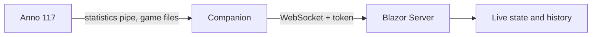

# Architecture

<!-- project:begin architecture -->
Censio reads the statistics of a running Anno 117 game on Windows and shows them live and over time in a
web application. A Windows Companion extracts the data; a Blazor Server application stores and displays it.

## Components

- **Companion** (Windows): reads the Anno 117 statistics pipe and the game files and sends the data to the server.
  Its logic lives in the platform-neutral `Censio.Companion.Core`; `Censio.Companion` is the thin Windows tray
  shell around it ([`decisions/0004`](decisions/0004-companion-shell-and-linux-build.md)).
- **Server** (Blazor Server): receives the data over a WebSocket (token-authenticated), keeps the live state and the history, and renders them.

The solution `Censio.slnx` holds eight production projects under `src/`, each with a test project under `tests/`
except the Windows shell:

| Project | Responsibility | References |
| ------- | -------------- | ---------- |
| `Censio.Contracts` | The types shared by Companion and server: the catalog document with its reader and writer ([`areas/game-catalog-format.md`](areas/game-catalog-format.md)), and the product version | — |
| `Censio.Pipe` | Framing and parsing the statistics pipe into typed messages and assembling them into ticks, recording frames to a file and replaying it, and anonymising a recording ([`areas/pipe.md`](areas/pipe.md), [`areas/pipe-recording.md`](areas/pipe-recording.md)) | — |
| `Censio.GameData` | Reading the game files (the RDA archives), building the catalog of names from them and reading the goods' and regions' icons from the UI archives (BC7 to PNG by own code) ([`areas/game-files.md`](areas/game-files.md), [`areas/game-catalog.md`](areas/game-catalog.md), [`areas/game-catalog-icons.md`](areas/game-catalog-icons.md), [`areas/game-catalog-cache.md`](areas/game-catalog-cache.md)) | — |
| `Censio.Server.Data` | Persistence of the server | — |
| `Censio.Server` | Web host, UI, later the ingest | Contracts, Server.Data |
| `Censio.Companion.Core` | The Companion's platform-neutral logic (tray menu and snapshot, single-instance rule, pipe connection state machine, command line, recording session and replay runner, tooltip texts, diagnostics window content and session, the log file writer, the autostart rules, the game installation search and the settings file, the catalog and icon loading, the catalog cache, the conversion of the catalog into the catalog document and the check of tick GUIDs) | Contracts, Pipe, GameData |
| `Censio.Anonymiser` | Contributor console tool that anonymises a recording; not released ([`areas/pipe-recording.md`](areas/pipe-recording.md), *Anonymising*) | Pipe |
| `Censio.Companion` | The Windows tray shell (WPF application, Windows Forms tray icon, the diagnostics window (with the icons shown as images), the registry store of the autostart value, the registry reader of Ubisoft Connect's install records and the file version reader); no test project | Companion.Core |

All assemblies carry the version of the build property `Version` (default `0.0.0`) as informational version
([`decisions/0005`](decisions/0005-product-version-from-one-build-property.md)). What each component does is in
[`areas/`](areas/README.md).

## Data flow

The Companion parses the pipe stream and the game files, extracts the game data and pushes it to the server.
The pipe stream is parsed strictly: a frame the parser cannot read is reported as an error, never guessed
([`decisions/0033`](decisions/0033-pipe-reader-strict-from-the-reference-source.md)); the game's side of the pipe as
observed is in [`protocol.md`](protocol.md).
The Companion opens the pipe itself, reconnects when the game restarts and shows the connection state in its tray
tooltip ([`decisions/0035`](decisions/0035-pipe-connection-states-retry-and-identification-level.md),
[`areas/pipe-connection.md`](areas/pipe-connection.md)). The Companion groups the messages into ticks with an island identity and session events
([`decisions/0034`](decisions/0034-ticks-assembled-by-close-rules-on-an-injected-clock.md)), in the live connection as in a replay, and the tray and the diagnostics window show the latest closed tick ([`decisions/0038`](decisions/0038-diagnostics-window-flat-table-of-rows-made-on-demand.md)).
From the tray menu (or from the start with `--record`) the Companion writes the frames of each connection to a local file, and with `--replay` it feeds
such a file through the same message reader and tick assembler instead of the pipe
([`decisions/0036`](decisions/0036-pipe-recording-raw-frames-and-replay-on-a-recorded-clock.md),
[`areas/pipe-recording.md`](areas/pipe-recording.md)).
A contributor can turn such a file into an anonymised copy with `Censio.Anonymiser`, the only way a recording may be committed as a test fixture
([`decisions/0042`](decisions/0042-recordings-anonymised-by-a-contributor-tool-rewriting-frames.md)).
The Companion logs through .NET's logging abstraction into its own rotating text file in the local app data folder
([`decisions/0037`](decisions/0037-companion-log-through-the-logging-abstraction-to-own-rotating-file.md),
[`areas/companion-log.md`](areas/companion-log.md)).
Once per start the Companion looks for the game installation in the background: the folder named in its settings file, else Ubisoft Connect's install records and default games folder, and shows the result and the program file's version as the build in the tray menu ([`decisions/0044`](decisions/0044-game-installation-found-through-ubisoft-connect-or-the-settings-file.md), [`decisions/0046`](decisions/0046-game-build-is-the-program-files-version.md), [`areas/game-installation.md`](areas/game-installation.md)).
At every start the Companion also loads or builds a catalog of regions, goods, workforce and buildings with their English and German names from the installation's `config.rda` in the background, shows them in the diagnostics window and logs the GUIDs it cannot name once. After the names it reads the icons of goods and regions from `ui.rda` and the `zz_patchfiles_<n>` archives, converts them to PNG, and shows them in the same window. A complete extraction is saved in a private cache file under `%LOCALAPPDATA%\Censio\Cache` (never sent), keyed by the game's file properties and the Companion's own build, so the next start loads it without reading the archives; each new pipe connection checks the game for a change and extracts again when it changed ([`decisions/0052`](decisions/0052-catalog-cache-keyed-by-file-properties-and-companion-identity.md), [`decisions/0053`](decisions/0053-catalog-cache-one-binary-file-validated-whole-before-use.md); [`decisions/0050`](decisions/0050-icons-found-by-a-path-rule-in-the-ui-and-patch-archives-newest-copy-wins.md), [`decisions/0051`](decisions/0051-dds-icons-decoded-by-own-bc7-and-png-code.md); [`decisions/0047`](decisions/0047-game-catalog-read-forward-only-from-config-rda-kinds-and-regions-from-the-data.md), [`decisions/0048`](decisions/0048-catalog-names-shown-in-the-diagnostics-window-unresolved-guids-logged-once.md), [`areas/game-catalog.md`](areas/game-catalog.md), [`areas/game-catalog-icons.md`](areas/game-catalog-icons.md), [`areas/game-catalog-cache.md`](areas/game-catalog-cache.md)).
The catalog converts into the versioned catalog document of `Censio.Contracts`, which nothing sends yet (#42) ([`decisions/0055`](decisions/0055-catalog-document-refers-to-icons-by-content-hash.md), [`decisions/0056`](decisions/0056-catalog-document-read-strictly-by-exact-schema-version.md), [`areas/game-catalog-format.md`](areas/game-catalog-format.md)).
The server accepts data only from a client that presents the ingest token. Guarantees are listed in
`.squad/project.md` (*Guarantees*) and linked to their decision record as they are made.

## Configuration

Configuration (server address, data directory, ingest token, cache and recording paths) comes from files and environment
variables and is validated at startup. The Companion's one setting, the game folder, is the optional file `%LOCALAPPDATA%\Censio\settings.json`, hand-edited and never written by the Companion ([`decisions/0045`](decisions/0045-companion-settings-in-a-json-file-under-local-app-data.md), [`areas/companion.md`](areas/companion.md), *Settings file*). The rules per area are in [`areas/`](areas/README.md).

## Security model

Untrusted input: the statistics pipe, the game files, the Companion's settings file, Ubisoft Connect's install records and the WebSocket ingest. The ingest token authenticates the
Companion; cache and recording paths are never derived from external input unchecked. Kept in sync with
`SECURITY.md` and the *Security areas* in `.squad/project.md`.

The Companion opens the pipe `\\.\pipe\anno117` read-only and at impersonation level identification, so the pipe's
server cannot act with the player's Windows identity; a pipe created by another program is read within the reader's
limits ([`areas/pipe-connection.md`](areas/pipe-connection.md), record 0035).

The game's RDA archives, found under a caller-named installation folder, are opened read-only and shared with the game,
and read within the reader's limits on blocks, entries and sizes; what the reader finds comes back as typed results,
never as exceptions, and no archive content leaves the machine ([`areas/game-files.md`](areas/game-files.md),
record 0043).

The settings file and Ubisoft Connect's install records are read only, within a 1 MiB bound for the file, into typed results that fail closed; no UNC or device path written in a record is followed, and a UNC folder the player writes in the settings file is probed over the network as the player's own choice ([`areas/game-installation.md`](areas/game-installation.md), record 0044).

The server speaks plain HTTP only; TLS is the reverse proxy's job. Its start page and `/health` need no login, and
`/health` reveals only its status ([`decisions/0006`](decisions/0006-server-plain-http-and-open-health.md),
[`areas/server.md`](areas/server.md)). Outside the Docker image it listens on loopback only; the image listens on
all interfaces of the container, and the published port decides who can reach it (record 0006).

## Deployment

The server is built into the Docker image `networlddev/censio` (linux/amd64, [`decisions/0026`](decisions/0026-server-image-linux-amd64-on-docker-hub-no-compose.md)) from `src/Censio.Server/Dockerfile`,
on Alpine bases of the .NET SDK and ASP.NET runtime pinned by digest, and runs as a non-root user; its behavior
is in [`areas/server.md`](areas/server.md), the choices in
[`decisions/0009`](decisions/0009-server-image-runs-as-a-fixed-non-root-user.md) and
[`decisions/0010`](decisions/0010-server-image-base-pinned-by-amd64-manifest-digest.md). The image keeps the data-protection key ring in `/config` (`Censio:DataDirectory`, [`decisions/0011`](decisions/0011-data-protection-key-ring-in-the-data-directory.md)). The Companion is
published as a Windows ZIP ([`decisions/0027`](decisions/0027-companion-zip-self-contained-single-file-unsigned.md)). A release is cut from a `vMAJOR.MINOR.PATCH` tag on `main` and published as a
pre-release: the workflow refuses a tag that is not the highest such tag (before the build and again before the promotion), builds and checks the ZIP and the image without secrets, publishes them, and only then
promotes the release, moving `latest` and *Latest* to it (*Latest* is GitHub's mark, which a writer can also set by hand); the release's write credentials are secrets of the environment `release`, which admits only runs on `v*` tags ([`decisions/0012`](decisions/0012-release-pre-release-first-and-secret-free-builds.md);
steps in [`CONTRIBUTING.md`](CONTRIBUTING.md), *Versioning and releases*).
<!-- project:end architecture -->

## Development process

This repository is developed with Claude Code: `AGENTS.md` holds the rules every AI coding agent reads, the
skills live under `.claude/skills/` and the squad roles under `.claude/agents/`. Every pull request is reviewed
before it is opened by the read-only reviewer in `.claude/agents/squad-reviewer.md`. The squad skills
(`squad-issue`, `squad-spec`) wrap that review in a bounded pipeline described in
[`.squad/routing.md`](../.squad/routing.md): a Lead plans, picks the tier that decides how much of the pipeline
runs and owns every decision; a Devil's Advocate challenges a feature's spec and, when routing says so, the
plan; Security reviews the plan when a security area is touched; tests come first, the gates run before the
review, and every loop limit ends in a Lead decision — only one the Lead cannot make reaches the human. The stack's commands live in
[`.squad/stack.md`](../.squad/stack.md), the project's guarantees and attack surface in
[`.squad/project.md`](../.squad/project.md).

The reasoning behind individual choices is kept out of this document and recorded instead as decision
records in [`docs/decisions/`](decisions/README.md); this document describes how the system works and
links a record where a guarantee or flow is the result of one.
