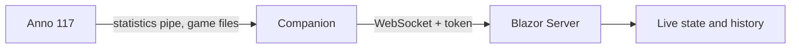

# Architecture

<!-- project:begin architecture -->
Censio reads the statistics of a running Anno 117 game on Windows and shows them live and over time in a
web application. A Windows Companion extracts the data; a Blazor Server application stores and displays it.

## Components

- **Companion** (Windows): reads the Anno 117 statistics pipe and the game files and sends the data to the server.
- **Server** (Blazor Server): receives the data over a WebSocket (token-authenticated), keeps the live state and the history, and renders them.

## Data flow

The Companion parses the pipe stream and the game files, extracts the game data and pushes it to the server.
The server accepts data only from a client that presents the ingest token. Guarantees are listed in
`.squad/project.md` (*Guarantees*) and linked to their decision record as they are made.

## Configuration

Configuration (server address, ingest token, cache and recording paths) comes from files and environment
variables and is validated at startup. The rules per area are in [`areas/`](areas/README.md).

## Security model

Untrusted input: the statistics pipe, the game files and the WebSocket ingest. The ingest token authenticates the
Companion; cache and recording paths are never derived from external input unchecked. Kept in sync with
`SECURITY.md` and the *Security areas* in `.squad/project.md`.

## Deployment

The server is built into a Docker image; the Companion is published as a Windows ZIP. A release is cut from a
`v*` tag.
<!-- project:end architecture -->

## Development process

This repository is developed with Claude Code: `AGENTS.md` holds the rules every AI coding agent reads, the
skills live under `.claude/skills/` and the squad roles under `.claude/agents/`. Every pull request is reviewed
before it is opened by the read-only reviewer in `.claude/agents/squad-reviewer.md`. The squad skills
(`squad-issue`, `squad-spec`) wrap that review in a bounded pipeline described in
[`.squad/routing.md`](../.squad/routing.md): a Lead plans, picks the tier that decides how much of the pipeline
runs and owns every decision; a Devil's Advocate challenges a feature's spec and, when routing says so, the
plan; Security reviews the plan when a security area is touched; tests come first, the gates run before the
review, and every loop limit ends in a Lead decision — only one the Lead cannot make reaches the human. The stack's commands live in
[`.squad/stack.md`](../.squad/stack.md), the project's guarantees and attack surface in
[`.squad/project.md`](../.squad/project.md).

The reasoning behind individual choices is kept out of this document and recorded instead as decision
records in [`docs/decisions/`](decisions/README.md); this document describes how the system works and
links a record where a guarantee or flow is the result of one.
