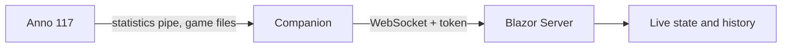

# Architecture

<!-- project:begin architecture -->
Censio reads the statistics of a running Anno 117 game on Windows and shows them live and over time in a
web application. A Windows Companion extracts the data; a Blazor Server application stores and displays it.

## Components

- **Companion** (Windows): reads the Anno 117 statistics pipe and the game files and sends the data to the server.
  Its logic lives in the platform-neutral `Censio.Companion.Core`; `Censio.Companion` is the thin Windows tray
  shell around it ([`decisions/0004`](decisions/0004-companion-shell-and-linux-build.md)).
- **Server** (Blazor Server): receives the data over a WebSocket (token-authenticated), keeps the live state and the history, and renders them.

The solution `Censio.slnx` holds seven production projects under `src/`, each with a test project under `tests/`
except the Windows shell:

| Project | Responsibility | References |
| ------- | -------------- | ---------- |
| `Censio.Contracts` | The types shared by Companion and server, and the product version | — |
| `Censio.Pipe` | Framing and parsing the statistics pipe into typed messages ([`areas/pipe.md`](areas/pipe.md)) | — |
| `Censio.GameData` | Reading the game files and the catalog | — |
| `Censio.Server.Data` | Persistence of the server | — |
| `Censio.Server` | Web host, UI, later the ingest | Contracts, Server.Data |
| `Censio.Companion.Core` | The Companion's platform-neutral logic (tray menu, single-instance rule) | Contracts, Pipe, GameData |
| `Censio.Companion` | The Windows tray shell (WPF application, Windows Forms tray icon); no test project | Companion.Core |

All assemblies carry the version of the build property `Version` (default `0.0.0`) as informational version
([`decisions/0005`](decisions/0005-product-version-from-one-build-property.md)). What each component does is in
[`areas/`](areas/README.md).

## Data flow

The Companion parses the pipe stream and the game files, extracts the game data and pushes it to the server.
The pipe stream is parsed strictly: a frame the parser cannot read is reported as an error, never guessed
([`decisions/0033`](decisions/0033-pipe-reader-strict-from-the-reference-source.md)).
The server accepts data only from a client that presents the ingest token. Guarantees are listed in
`.squad/project.md` (*Guarantees*) and linked to their decision record as they are made.

## Configuration

Configuration (server address, data directory, ingest token, cache and recording paths) comes from files and environment
variables and is validated at startup. The rules per area are in [`areas/`](areas/README.md).

## Security model

Untrusted input: the statistics pipe, the game files and the WebSocket ingest. The ingest token authenticates the
Companion; cache and recording paths are never derived from external input unchecked. Kept in sync with
`SECURITY.md` and the *Security areas* in `.squad/project.md`.

The server speaks plain HTTP only; TLS is the reverse proxy's job. Its start page and `/health` need no login, and
`/health` reveals only its status ([`decisions/0006`](decisions/0006-server-plain-http-and-open-health.md),
[`areas/server.md`](areas/server.md)). Outside the Docker image it listens on loopback only; the image listens on
all interfaces of the container, and the published port decides who can reach it (record 0006).

## Deployment

The server is built into the Docker image `networlddev/censio` (linux/amd64, [`decisions/0026`](decisions/0026-server-image-linux-amd64-on-docker-hub-no-compose.md)) from `src/Censio.Server/Dockerfile`,
on Alpine bases of the .NET SDK and ASP.NET runtime pinned by digest, and runs as a non-root user; its behavior
is in [`areas/server.md`](areas/server.md), the choices in
[`decisions/0009`](decisions/0009-server-image-runs-as-a-fixed-non-root-user.md) and
[`decisions/0010`](decisions/0010-server-image-base-pinned-by-amd64-manifest-digest.md). The image keeps the data-protection key ring in `/config` (`Censio:DataDirectory`, [`decisions/0011`](decisions/0011-data-protection-key-ring-in-the-data-directory.md)). The Companion is
published as a Windows ZIP ([`decisions/0027`](decisions/0027-companion-zip-self-contained-single-file-unsigned.md)). A release is cut from a `vMAJOR.MINOR.PATCH` tag on `main` and published as a
pre-release: the workflow refuses a tag that is not the highest such tag (before the build and again before the promotion), builds and checks the ZIP and the image without secrets, publishes them, and only then
promotes the release, moving `latest` and *Latest* to it (*Latest* is GitHub's mark, which a writer can also set by hand); the release's write credentials are secrets of the environment `release`, which admits only runs on `v*` tags ([`decisions/0012`](decisions/0012-release-pre-release-first-and-secret-free-builds.md);
steps in [`CONTRIBUTING.md`](CONTRIBUTING.md), *Versioning and releases*).
<!-- project:end architecture -->

## Development process

This repository is developed with Claude Code: `AGENTS.md` holds the rules every AI coding agent reads, the
skills live under `.claude/skills/` and the squad roles under `.claude/agents/`. Every pull request is reviewed
before it is opened by the read-only reviewer in `.claude/agents/squad-reviewer.md`. The squad skills
(`squad-issue`, `squad-spec`) wrap that review in a bounded pipeline described in
[`.squad/routing.md`](../.squad/routing.md): a Lead plans, picks the tier that decides how much of the pipeline
runs and owns every decision; a Devil's Advocate challenges a feature's spec and, when routing says so, the
plan; Security reviews the plan when a security area is touched; tests come first, the gates run before the
review, and every loop limit ends in a Lead decision — only one the Lead cannot make reaches the human. The stack's commands live in
[`.squad/stack.md`](../.squad/stack.md), the project's guarantees and attack surface in
[`.squad/project.md`](../.squad/project.md).

The reasoning behind individual choices is kept out of this document and recorded instead as decision
records in [`docs/decisions/`](decisions/README.md); this document describes how the system works and
links a record where a guarantee or flow is the result of one.
